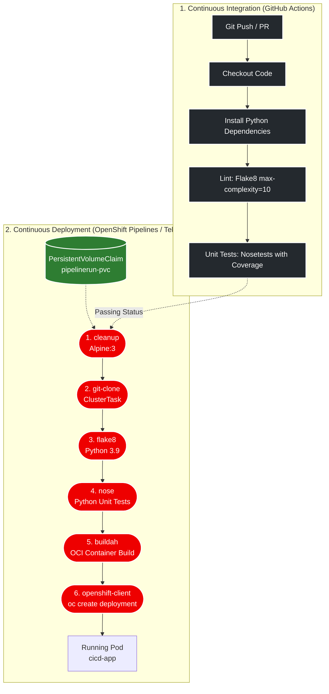

# CI/CD Tools and Practices Final Project Template

## Project Name: ci-cd-final-project

<p align="center">
  <a href="https://github.com/Sairaj213/ci-cd-final-project/actions/workflows/workflow.yml">
    
  </a>
  
  
  
  
  
  
</p>

This repository contains the complete implementation of the **Continuous Integration and Continuous Delivery (CI/CD) Final Project** for the Coursera course **CI/CD Tools and Practices** (IBM Skills Network).

---

## 🎯 Architecture & CI/CD Pipeline

The solution implements a dual-tier automated delivery pipeline:

1. **Continuous Integration (GitHub Actions):** Triggered automatically on push and pull requests to `main`, validating syntax, style standards, and test suites across isolated container environments.
2. **Continuous Deployment (Tekton / Red Hat OpenShift Pipelines):** An automated cloud-native CD pipeline that prepares workspaces, clones code, runs quality gates, builds OCI container images with Buildah, and deploys services to Kubernetes/OpenShift.



---

## 🚀 REST API Service Overview

The backend microservice provides a RESTful API for managing numeric counters:

| HTTP Method | Endpoint | Description |
|:---:|:---|:---|
| `GET` | `/` | Service health status and metadata |
| `GET` | `/counters` | List all tracked counters |
| `POST` | `/counters/<name>` | Create a new counter initialized to zero |
| `GET` | `/counters/<name>` | Retrieve current counter value |
| `PUT` | `/counters/<name>` | Increment counter value by 1 |
| `DELETE` | `/counters/<name>` | Remove counter |

---

## 📂 Project Structure & Manifests

```text
ci-cd-final-project/
├── .github/
│   └── workflows/
│       └── workflow.yml        # GitHub Actions CI Workflow
├── .tekton/
│   ├── tasks.yml               # Tekton Custom Tasks (cleanup, nose)
│   ├── pipeline.yaml           # 6-step declarative OpenShift CD Pipeline
│   ├── pvc.yaml                # PersistentVolumeClaim for workspace
│   └── pipelinerun.yaml        # PipelineRun execution trigger
├── service/
│   ├── routes.py               # REST API endpoints
│   └── common/                 # Logging and error handlers
├── tests/
│   └── test_routes.py          # Automated unit test suite
├── Dockerfile                  # Container build recipe
├── requirements.txt            # Python dependencies
├── setup.cfg                   # Test and coverage configuration
└── README.md                   # Project documentation
```

---

## 🧪 Running Locally

1. **Clone repository:**
   ```bash
   git clone https://github.com/Sairaj213/ci-cd-final-project.git
   cd ci-cd-final-project
   ```

2. **Install dependencies:**
   ```bash
   pip install -r requirements.txt
   ```

3. **Run Code Quality Linting:**
   ```bash
   flake8 service --count --max-complexity=10 --max-line-length=127 --statistics
   ```

4. **Execute Unit Tests:**
   ```bash
   nosetests -v --with-spec --spec-color --with-coverage --cover-package=service
   ```

---

## 📜 License & Acknowledgements

- **License:** Apache License 2.0. See [LICENSE](LICENSE) for details.
- **Author:** Skills Network / IBM Developer Skills Network
- **Repository Owner:** [Sairaj213](https://github.com/Sairaj213)
